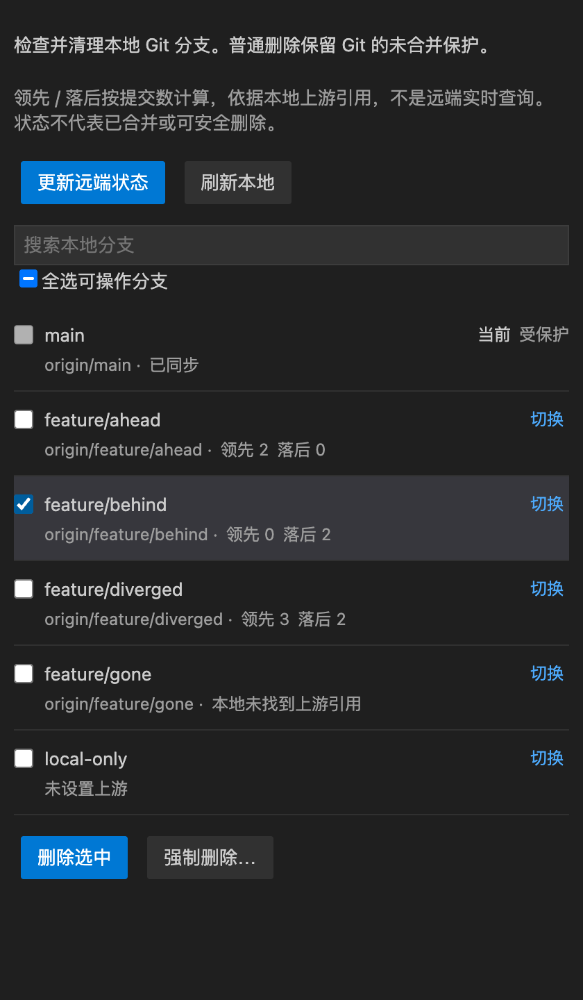
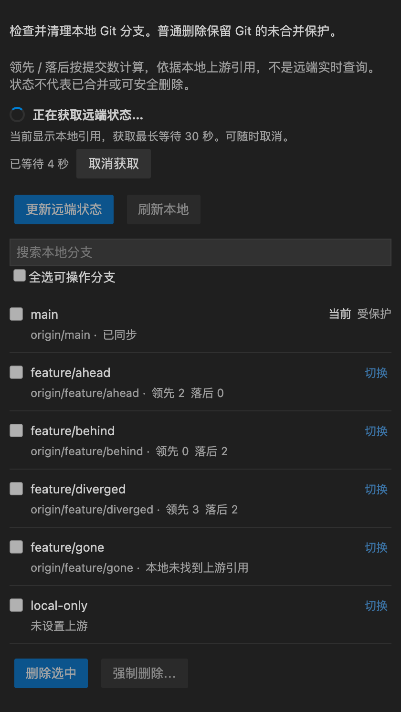
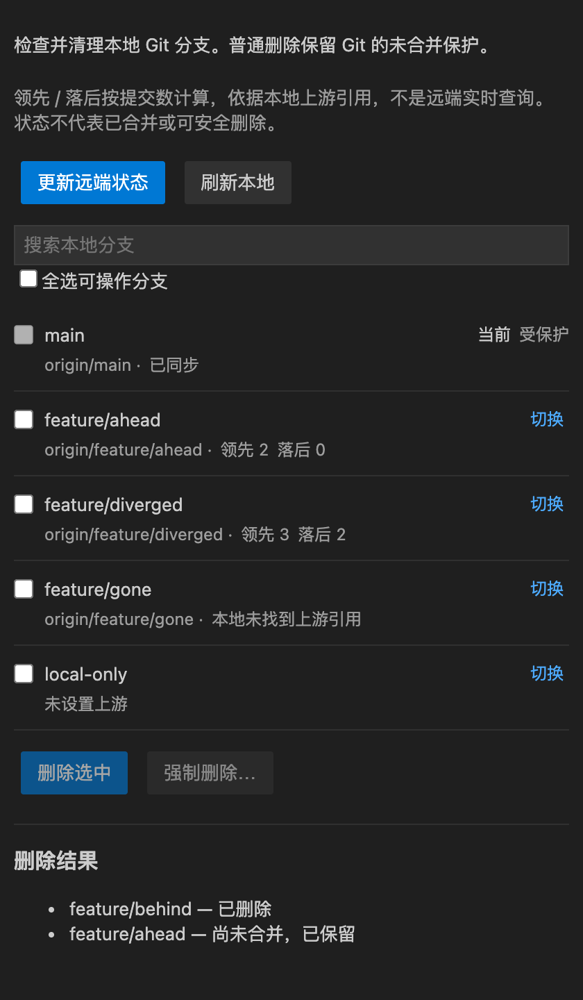

# Git Branch Pruner

一个轻量的 VS Code 本地 Git 分支清理工具。查看各分支与上游的提交差距，选中不再需要的分支，再批量删除。

[English](README_EN.md) | 简体中文

**只删除本地分支，不删除远程分支。** 打开侧栏只读取本地状态，点击“更新远端状态”才联网获取。

*截图由当前 Webview 使用演示数据渲染，配色模拟 VS Code 深色主题；不包含真实工作仓库，也不是完整 VS Code 窗口截图。*

## 开始使用

1. 在扩展面板搜索 **Git Branch Pruner**，确认发布者为 `monkeykjy` 后安装。
2. 打开一个 Git 仓库，点击活动栏中的 **Git Branch Pruner** 图标，进入“本地分支”视图。扩展使用工作区的第一个文件夹。
3. 查看分支状态。需要获取服务器上的最新信息时，点击“更新远端状态”。
4. 勾选要清理的分支，点击“删除选中”，核对确认弹窗中的仓库、目标分支和删除范围。
5. 查看逐项删除结果。尚未合并的分支会保留，需要强制删除时使用单独的“强制删除…”入口。

本文介绍当前源码版本；已发布版本可能尚未包含本轮更新。

## 查看与筛选分支

- 当前分支置顶，每行展示分支名、实际上游和状态。
- 搜索本地分支，或使用“切换”切换分支；切换失败不会自动丢弃工作区改动。
- 自动跟随终端和其他 Git 工具产生的引用变化，包括切换、提交、分支创建或删除、外部 fetch。
- 自动更新保留搜索条件、仍然有效的勾选和滚动位置。

| 状态 | 含义 |
| --- | --- |
| 领先 3 / 落后 2 | 本地有 3 个上游未包含的提交，上游有 2 个本地未包含的提交 |
| 已同步 | 本地与配置的远端上游没有独有提交 |
| 未设置上游 | 没有配置比较对象，不显示虚假的 0/0 |
| 本地未找到上游引用 | 本地没有对应引用，不能据此确认服务器已删除分支 |
| 跟踪本地分支 | 上游是本地分支，不显示相对远端的提交差距 |
| 差距暂不可用 | 暂时无法计算差距，不将它当成已同步 |
| 当前 / 受保护 / 工作树使用中 | 禁止删除，包括强制删除 |

领先和落后以提交数为单位，比较对象显示在分支行中，例如 `origin/feature/login`，不是统一与 main 比较。数字来自本地已有历史和远程跟踪引用；浅克隆只能反映已获取的历史。

**分支状态不代表删除安全性。** 已同步或本地缺少上游引用，都不等于已合并到主分支。

## 更新状态

| 操作 | 行为 |
| --- | --- |
| 打开侧栏、自动更新、“刷新本地” | 重读本地分支和缓存引用，不联网 |
| “更新远端状态” | 执行 `git fetch --all --prune`，再重读本地状态 |
| 在外部终端或 Git 工具中 fetch | 自动重读变化后的本地引用，更新提交差距 |

`fetch --prune` 清理过期的远程跟踪引用，不会替你删除本地分支，也不执行 pull、merge 或 push。多个 remote 的获取范围遵循 Git 配置，包括 `skipFetchAll`；扩展沿用 Git 的代理和认证配置。

获取期间可以浏览和搜索列表；重复获取、切换、选择和删除暂时禁用。侧栏显示等待秒数和“取消获取”，30 秒触发获取超时，没有重复的右下角进度通知。

获取结束后立即停止计时并移除取消按钮；后续显示“正在刷新本地状态”，本地重读完成或失败后恢复操作。失败、取消或超时不会清空列表，提示会说明部分引用可能已经更新，不能确认所有远端状态。

手动 fetch 完成时间只记录当前视图会话中插件发起的成功获取，不保证服务器当前状态，也不是每个 remote 的独立更新时间。本地刷新和外部 fetch 不改写此时间；重新创建视图后清空记录。远端结果提示会保留到下一次手动获取，不因本地刷新或切换失败而消失。

## 清理本地分支

- **普通删除**使用 `git branch -d`，保留 Git 的未合并保护。Git 按上游或 HEAD 判断，不一定是默认分支。
- **强制删除**使用 `git branch -D`，跳过未合并检查，可能移除指向未合并提交的分支引用，需要明确确认。
- 确认弹窗先说明本地范围、删除模式和保护规则，再展示仓库和完整编号目标列表。
- 当前分支、main/master、通过本地 remote HEAD 识别的默认分支，以及被 worktree 占用的分支，均在执行时再次检查并保护。
- 批量操作逐项返回结果。某个分支未删除，不会被当作整批成功，也不会自动升级为强制删除。

## 中文与英文

界面跟随 **VS Code 显示语言**，提供简体中文和英文文案，包括分支状态、按钮、加载提示、删除确认和结果。扩展简介及“本地分支”视图标题也提供简体中文翻译；产品名 Git Branch Pruner 保留英文。

在命令面板执行 **Configure Display Language**，选择 `zh-cn` 或 `en`，按 VS Code 提示安装语言包并重启即可。扩展没有单独的语言切换开关；其他中文区域设置的界面正文仍使用简体中文，其余语言使用英文。Git 名称、分支名和诊断日志不翻译。

## 系统要求与开发

- VS Code 1.80.0 或更高版本。
- Git 2.40.0 或更高版本，并可在 PATH 中找到。
- 开发和测试使用 Node.js 22、pnpm，详见 [开发说明](https://github.com/monkeykjy/git-branch-pruner/blob/main/docs/002.DEVELOPMENT.md)。
- `pnpm run demo` 在项目的 `../tmp/demo/run-XXXXXX/` 下生成独立测试环境，步骤见 [手动验收清单](https://github.com/monkeykjy/git-branch-pruner/blob/main/docs/005.MANUAL_TESTS.md)。

当前聚焦本地分支清理，不提供创建分支、删除远程分支或自动清理功能。

## 反馈与许可证

问题和建议请提交至 [GitHub Issues](https://github.com/monkeykjy/git-branch-pruner/issues)。更新记录见 [CHANGELOG.md](CHANGELOG.md)，许可证为 [MIT](LICENSE)。
