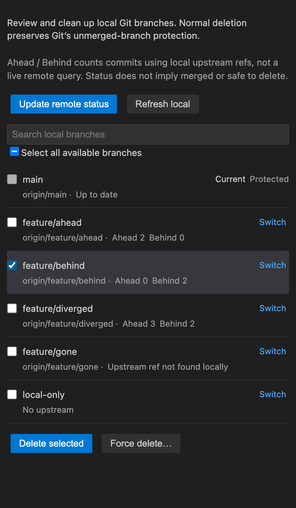
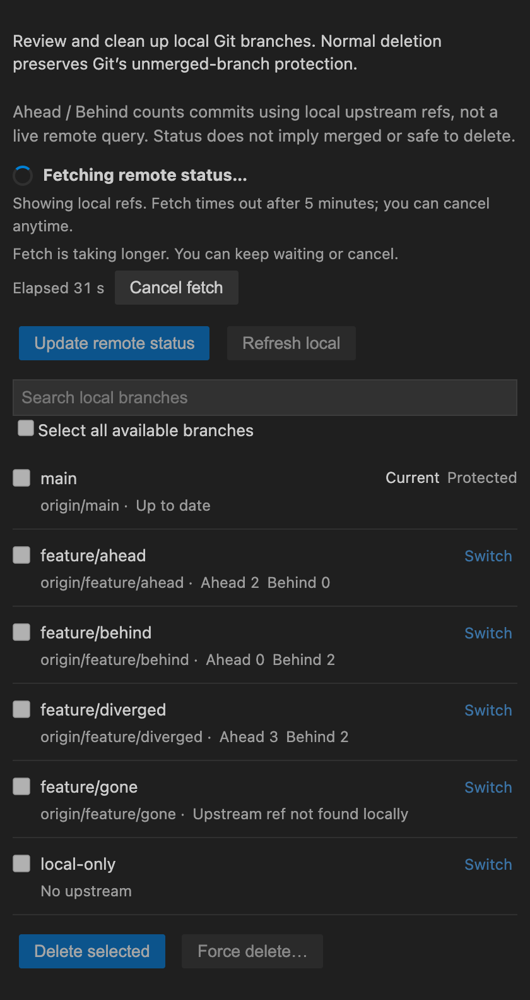
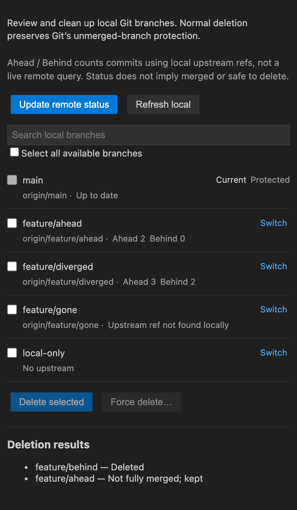

# Git Branch Pruner

A lightweight VS Code tool for cleaning up local Git branches. Review each branch's commit differences from its upstream, select branches you no longer need, and delete them in a batch.

English | [简体中文](README.md)

**Only local branches are deleted. Remote branches are unaffected.** Opening the sidebar reads local state; fetching requires a click on **Update remote status**.

*Screenshots render the current Webview with demo data and colors modeled on VS Code's dark theme. They contain no real work repository and are not full VS Code window captures.*

## Getting Started

1. Search for **Git Branch Pruner** in the Extensions view and install the extension published by `monkeykjy`.
2. Open a Git repository, then click **Git Branch Pruner** in the Activity Bar to open **Local Branches**. The extension uses the first workspace folder.
3. Review branch status. Click **Update remote status** when you need fresh information from the server.
4. Select branches, click **Delete selected**, and check the repository, target branches and scope in the confirmation dialog.
5. Review the result for each branch. Unmerged branches are kept; use the separate **Force delete…** action when needed.

This guide describes the current source version. The published version may not yet include these updates.

## Review and Filter Branches

- The current branch appears first. Each row shows its name, actual upstream and status.
- Search local branches or use **Switch** to change branches. A failed switch never automatically discards worktree changes.
- Follow ref changes made in terminals and other Git tools, including checkout, commits, branch creation or deletion, and external fetches.
- Automatic updates preserve the search query, selections that are still valid and the scroll position.

| Status | Meaning |
| --- | --- |
| Ahead 3 / Behind 2 | Three commits unique to the local branch and two unique to its upstream |
| Up to date | Neither the local branch nor its configured remote upstream has unique commits |
| No upstream | No comparison target is configured; no misleading 0/0 counts |
| Upstream ref not found locally | The local ref is missing; this does not prove server-side deletion |
| Local upstream | The upstream is a local branch; remote commit differences are not shown |
| Comparison unavailable | Counts cannot currently be calculated; this is not treated as up to date |
| Current / Protected / In use by worktree | Deletion is blocked, including force deletion |

Ahead and Behind count commits against the upstream shown in that row, such as `origin/feature/login`. Branches are not universally compared with main. Counts use local history and remote-tracking refs; shallow clones can only reflect history already fetched.

**Branch status does not establish deletion safety.** Being up to date or missing an upstream ref locally does not mean a branch has been merged into main.

## Update Status

| Action | Behavior |
| --- | --- |
| Open the sidebar, automatic updates, or **Refresh local** | Reread local branches and cached refs without network access |
| **Update remote status** | Run `git fetch --all --prune`, then reread local state |
| Fetch in a terminal or another Git tool | Automatically reread changed local refs and update commit counts |

`fetch --prune` removes stale remote-tracking refs. It does not delete local branches or run pull, merge or push. Fetch scope follows Git configuration, including `skipFetchAll` for multiple remotes. The extension inherits Git's proxy and authentication settings.

During fetch, you can browse and search the list. Duplicate fetches, switching, selection and deletion are temporarily disabled. The sidebar shows elapsed seconds and **Cancel fetch**, with no duplicate notification popup. After 30 seconds, a notice offers continued waiting or cancellation; fetch keeps running until it completes, is cancelled or reaches the five-minute timeout.

When fetch ends, its timer and cancel button disappear immediately. **Refreshing local state** appears until the local read completes or fails, then controls are restored. Failure, cancellation and timeout leave the list visible and explain that some refs may have updated without confirming every remote's state.

On failure, the sidebar expands **Git error details**, showing the exit code and original Git error text for selection and copying. The same details are written to the **Git Branch Pruner** output channel. URLs and common authentication fields are hidden; long output retains its beginning and end. Missing error output is explicitly identified instead of treating every failure as a network issue.

The manual fetch timestamp records only successful fetches started by the extension in the current view session. It does not guarantee current server state or track each remote independently. Local refreshes and external fetches do not change it; recreating the view clears it. Remote outcome notices remain until the next manual fetch and survive local refreshes and failed switches.

## Clean Up Local Branches

- **Normal deletion** uses `git branch -d` and preserves Git's unmerged-branch protection. Git checks against upstream or HEAD, not necessarily the default branch.
- **Force deletion** uses `git branch -D`, skips the merge check and may remove references to unmerged commits. It requires explicit confirmation.
- The confirmation shows local-only scope, deletion mode and protection rules before the repository and complete numbered target list.
- The current branch, main/master, default branches identified through local remote HEAD refs, and branches occupied by worktrees are checked again and protected at execution time.
- Batch operations report each result. A branch that could not be deleted is not counted as a success, and failures never escalate automatically to force deletion.

## English and Chinese

The interface follows **VS Code's display language**, with English and Simplified Chinese text for branch status, buttons, progress, deletion confirmations and results. The extension description and **Local Branches** view title also have Simplified Chinese translations. The product name Git Branch Pruner stays in English.

Run **Configure Display Language** from the Command Palette, select `en` or `zh-cn`, and follow VS Code's prompts to install a language pack and restart. There is no separate language switch in the extension. Other Chinese locales use Simplified Chinese for the Webview and operation messages; other languages fall back to English. Git identifiers, branch names and diagnostic logs are not translated.

## Requirements and Development

- VS Code 1.80.0 or later.
- Git 2.40.0 or later. The extension prefers the executable identified by VS Code’s built-in Git extension, including its selected `git.path` configuration. If the API is unavailable or path resolution exceeds two seconds, it falls back to the extension host’s PATH. Git must still be installed; no additional extension configuration is needed.
- Development and tests use Node.js 22 and pnpm. See the [development guide](https://github.com/monkeykjy/git-branch-pruner/blob/main/docs/002.DEVELOPMENT.md).
- Run `pnpm run demo` to create an isolated fixture under the project's `../tmp/demo/run-XXXXXX/`, then follow the [manual acceptance checklist](https://github.com/monkeykjy/git-branch-pruner/blob/main/docs/005.MANUAL_TESTS.md).

The extension focuses on local branch cleanup. It does not create branches, delete remote branches or clean up branches automatically.

## Feedback and License

Report issues or suggestions on [GitHub Issues](https://github.com/monkeykjy/git-branch-pruner/issues). See [CHANGELOG.md](CHANGELOG.md) for updates. Licensed under [MIT](LICENSE).
